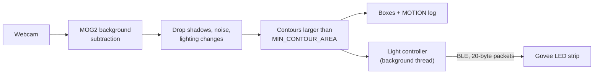

<p align="center">
  
</p>

<h1 align="center">simple-motion</h1>

<p align="center">
  <b>Your webcam sees movement, your Govee LED strip lights up.</b><br>
  Motion detection with OpenCV plus local Bluetooth control. No cloud, no Govee app, no account.
</p>

<p align="center">
  <a href="https://github.com/parsanaji/simple-motion/actions/workflows/tests.yml"></a>
  
  
  <a href="LICENSE"></a>
</p>

---

Walk into the room and the strip turns red. Sit still for 10 seconds and it
turns off. The detector also prints a timestamped `MOTION` line, so you get a
simple activity log.

```text
$ python motion_detect.py
[govee] scanning for H6147
Camera 0 open at 1280x720. Press q in the window to quit.
[govee] connected to GBK_H6147_1A2B
MOTION 2026-11-14 13:25:16 (2 areas)
[govee] light on
MOTION 2026-11-14 13:25:21 (5 areas)
[govee] light off (10s without motion)
```

## Features

- **Live view.** A window shows the camera feed with green boxes around everything that moves.
- **Motion log.** Prints `MOTION <timestamp>`, with a cooldown (3 s by default) so it doesn't spam.
- **Light automation.** On motion the strip turns on in your colour. After a set time without motion it turns off.
- **Ignores noise.** Tiny changes (minimum contour area), shadows, whole-room lighting changes, and the strip's own glow are not counted as motion.
- **Finds the strip by name** over Bluetooth LE, and reconnects by itself if the link drops.
- **Works on macOS and Windows.** It picks the right camera backend for each platform.

## How it works



1. **Background subtraction (MOG2).** OpenCV learns what the empty scene looks like. Any pixel that differs is foreground.
2. **Cleanup.** Shadow pixels are removed, then a morphological open (which erases specks) and a dilation (which merges nearby blobs). If more than half the frame changes at once, the frame counts as a lighting change, not motion.
3. **Contours.** Changed regions smaller than `MIN_CONTOUR_AREA` are ignored. The rest get a bounding box. Detection runs on a 640 px wide copy of the frame, so the threshold works the same at any camera resolution.
4. **Light control.** A background thread keeps one Bluetooth connection open to the strip. It turns the strip on at the first motion and off after `LIGHT_HOLD_SECONDS` without motion. For 2 s after each switch, the detector ignores motion and quickly re-learns the scene, so the light's own glow can't trigger it.

## Quick start

You need Python 3.10+, a webcam, and (optionally) a Govee Bluetooth LED strip.

**macOS**

```sh
git clone https://github.com/parsanaji/simple-motion.git
cd simple-motion
python3 -m venv .venv
.venv/bin/pip install -r requirements.txt

.venv/bin/python motion_detect.py --list-cameras   # find your camera's index
.venv/bin/python motion_detect.py                  # go
```

**Windows** (PowerShell or cmd)

```bat
git clone https://github.com/parsanaji/simple-motion.git
cd simple-motion
py -m venv .venv
.venv\Scripts\pip install -r requirements.txt

.venv\Scripts\python motion_detect.py --list-cameras
.venv\Scripts\python motion_detect.py
```

Press **q** (or Esc) in the video window to quit. If the light is on when you quit, it turns off.

> No Govee strip? Run with `--no-govee` to use it as a plain motion detector.

## Configuration

All settings are in the `CONFIG` block at the top of [`motion_detect.py`](motion_detect.py).

| Setting | Default | What it does |
|---|---|---|
| `CAMERA_INDEX` | `0` | Which camera to use. Use `--list-cameras` to find it. |
| `FRAME_WIDTH` / `FRAME_HEIGHT` | `1280` / `720` | Requested capture size. |
| `MIN_CONTOUR_AREA` | `800` | Smallest moving area (in px², measured at 640 px width) that counts as motion. Raise it if small things trigger it. |
| `COOLDOWN_SECONDS` | `3.0` | Minimum time between `MOTION` prints. |
| `WARMUP_SECONDS` | `2.0` | Motion is ignored at startup while the camera's exposure settles. |
| `MAX_CHANGED_FRACTION` | `0.5` | If more than this share of the frame changes at once, it's treated as lighting, not motion. |
| `GOVEE_ENABLED` | `True` | Set to `False` to never use Bluetooth. |
| `GOVEE_DEVICE_NAME` | `"H6147"` | Text matched inside the strip's Bluetooth name (e.g. `ihoment_H6147_1A2B`). |
| `GOVEE_COLOR` | `(255, 0, 0)` | RGB colour shown on motion. |
| `GOVEE_COLOR_VARIANT` | `"rgb-02"` | Colour packet format (see [Other Govee models](#other-govee-models)). |
| `LIGHT_HOLD_SECONDS` | `10.0` | How long without motion before the strip turns off. |
| `LIGHT_SETTLE_SECONDS` | `2.0` | Motion is ignored for this long after the strip switches. |

## Command-line options

| Flag | What it does |
|---|---|
| `--list-cameras` | Show the available camera indexes and exit. |
| `--camera N` | Use camera `N` instead of `CAMERA_INDEX`. |
| `--no-govee` | Motion detection only, no Bluetooth. |
| `--hold S` | Override `LIGHT_HOLD_SECONDS`. |
| `--seconds S` | Quit by itself after `S` seconds (handy for testing). |
| `-v`, `--verbose` | Log every packet sent to the strip and every reply from it. |

## Just the light: `govee_h6147.py`

A standalone script that finds the strip, turns it solid red for 5 seconds and
then turns it off. Use it to check that Bluetooth works before you add the camera.

```sh
.venv/bin/python govee_h6147.py --scan              # list nearby Govee devices
.venv/bin/python govee_h6147.py                     # interactive: confirms which colour packet works
.venv/bin/python govee_h6147.py --variant rgb-02    # no prompts
```

## Other Govee models

The code was tested on an **H6147**, but most Govee Bluetooth lights use the same protocol.

1. Run `govee_h6147.py --scan` to see what your strip advertises (e.g. `GBK_H618E_1A2B`).
2. Run `govee_h6147.py --model H618E`. It tries each colour format and asks whether the strip turned red.
3. Put the model in `GOVEE_DEVICE_NAME` and the format that worked in `GOVEE_COLOR_VARIANT`.

| Variant | Packet (after `33 05`) | Typical devices |
|---|---|---|
| `rgb-02` | `02 R G B` | Classic RGB strips (H6147 ✓) |
| `rgb-0d` | `0D R G B` | Newer RGB firmware |
| `rgbic-1501` | `15 01 R G B 00×5 FF 7F` | RGBIC segment strips, all segments |
| `rgbic-0b` | `0B R G B 00×5 FF 7F` | Older RGBIC firmware |

<details>
<summary><b>Govee BLE protocol cheat sheet</b></summary>

Every command is written to characteristic `00010203-0405-0607-0809-0a0b0c0d2b11`
as exactly **20 bytes**: a header, a command and a payload, padded with zeros
to 19 bytes, then **one XOR checksum byte** computed over the first 19.

| Purpose | Bytes |
|---|---|
| Power on | `33 01 01 00 … 00 33` |
| Power off | `33 01 00 00 … 00 32` |
| Solid red (`rgb-02`) | `33 05 02 FF 00 00 00 … 00 CB` |
| Keep-alive (every ~2 s) | `AA 01 00 … 00 AB` |

The strip echoes each accepted command on the notify characteristic `…2b10`
(e.g. `33 05 00 …`). That is what `-v` shows.
</details>

## Troubleshooting

| Problem | Fix |
|---|---|
| `Could not open camera` on macOS | System Settings → Privacy & Security → **Camera**: allow your terminal app. The script waits 20 s on the first run while you click Allow. |
| Strip not found | Close the Govee phone app (a strip accepts **only one** Bluetooth connection at a time) and stay within ~5 m. On macOS, also allow **Bluetooth** for your terminal. |
| Light turns itself back on right after turning off | Its glow or your camera's auto-exposure counts as motion. Raise `LIGHT_SETTLE_SECONDS`. |
| Small things (pets, curtains, screens) trigger it | Raise `MIN_CONTOUR_AREA`. |
| Wrong camera opens | iPhones (Continuity Camera) and virtual cameras shift the indexes. Run `--list-cameras` and set `CAMERA_INDEX`. |
| `python: command not found` / `externally-managed-environment` on a Mac | Homebrew Python has only `python3` and blocks global `pip`. Use the venv from Quick start. |
| Camera slow to open on Windows | Already handled: the script uses DirectShow with MJPG instead of the slow default backend. |

## Development

```sh
.venv/bin/pip install pytest
.venv/bin/python -m pytest -q
```

The tests run offline, with no camera or strip needed. They check the packet
bytes and checksums against known reference packets, run motion detection on
synthetic frames (large object, tiny speck, lighting change), and cover the
cooldown and on/off timing. CI runs them on macOS and Windows.

## License

[MIT](LICENSE). Not affiliated with or endorsed by Govee.
